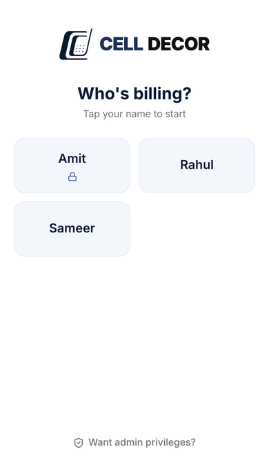
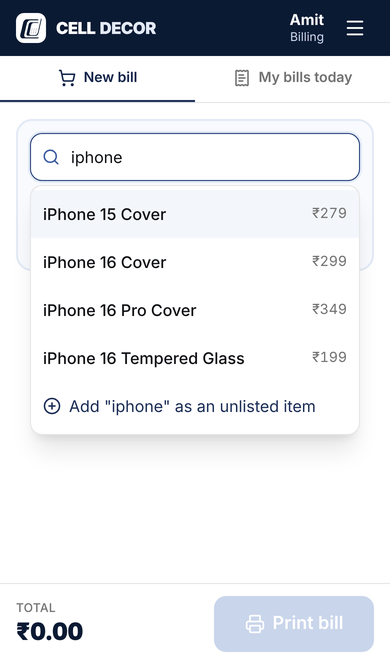
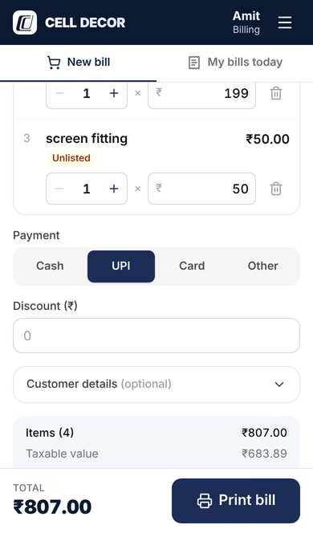

<p align="center"></p>

# Cell Decor Billing

Billing for the Cell Decor mobile accessories shop. Staff bill on their iPhones over the shop Wi-Fi,
and the shop laptop saves every bill and prints a GST slip on the thermal printer at once. The owner
manages items and staff and sees who sold what.

<p>
  
  
  
</p>

## What it does

- **Staff login:** tap your name; enter your PIN if you set one. "Want admin privileges?" leads to
  the admin password screen.
- **Billing:** search an item ("iphone 16" finds every item with those words), set qty and rate, Add.
  The bill shows GST live. Print saves the bill, numbers it and prints the slip in one step.
- **Unlisted items:** if the admin allows it, staff can bill an item that is not in the list yet. It
  is marked Unlisted and shows up on the admin's Items page to add.
- **Reprints and voids:** reprints print DUPLICATE COPY and are logged. Only the admin can void a
  bill, with a reason; voided bills drop out of sales.
- **Admin:** live view of today, all bills, per-employee reports (sales, bills, items, discounts,
  voids, hours), items, employees and PINs, shop and GST settings, printer setup and test print.

## How it is built

| Part     | Choice                                                                            |
| -------- | --------------------------------------------------------------------------------- |
| Server   | Node, TypeScript, Express, on the shop laptop                                     |
| Database | PostgreSQL on the same laptop, plain SQL migrations (`server/src/db/migrations`)  |
| Web app  | React 19, Vite, Tailwind CSS 4, TanStack Query, served by the same server         |
| Printing | `server/vendor/universal-printer.cjs` (RAW ESC/POS through the Windows spooler)   |
| Shared   | `shared/` holds the GST maths, money, search and invoice rules used by both sides |

Money is integer paise everywhere. Prices are GST-inclusive; the server works out taxable value,
CGST and SGST per line. Invoice numbers look like `CD/26-27/00001`, have no gaps and restart every
April.

```
server/src     API, auth, bills, printing, reports
server/test    API tests against a real Postgres
web/src        the phone and admin screens
shared         code used by both server and web
scripts        Windows backup scripts
docs           INSTALL.md and screenshots
```

## Develop

You need Node 20+ and a local Postgres.

```bash
npm install
cp .env.example .env            # set DATABASE_URL; PRINTER_OVERRIDE=file:/tmp/slip.bin prints to a file
npm run create-admin            # creates the tables and the admin account
npm run dev                     # API on :3000, web app on :5173 (open it from a phone on the same Wi-Fi)
```

| Command                | What it does                                                                      |
| ---------------------- | --------------------------------------------------------------------------------- |
| `npm run dev`          | Server with reload, plus the Vite dev server                                      |
| `npm run build`        | Builds the web app and compiles the server into `dist/`                           |
| `npm start`            | Runs the built app (also applies new migrations)                                  |
| `npm test`             | Unit tests and API tests (needs `TEST_DATABASE_URL` or the default test database) |
| `npm run lint`         | Type checks server and web                                                        |
| `npm run format`       | Prettier                                                                          |
| `npm run printer:list` | Lists printers the laptop can see                                                 |

The API tests drop and rebuild the schema of the test database, so never point
`TEST_DATABASE_URL` at real data.

## Install at the shop

See [docs/INSTALL.md](docs/INSTALL.md): Postgres, the app as a Windows service, printer setup,
router and laptop settings, iPhone home-screen icons, and nightly backups.

## Not built yet

Commission (the rule is still to be decided; bills already have a `commission_rate_bp` column),
inventory and stock counts, a daily summary message to the owner, HTTPS on the LAN, and a native
iPhone app.

---

Private project for Cell Decor. All rights reserved.
